# AI Bill Analytics — AWS Architecture & Data Flow Guide

    

End-to-end **Lambda Architecture** on AWS for multi-tenant LLM token billing, cost reconciliation, and real-time budget alerting. All deployment runbooks and scripts live under `AWS_Setup/`, `local_project/jobs/`, `local_project/producers/`, `local_project/db/init/`, and `local_project/grafana/`.

## 1. End-to-End Architecture & Intermediate Artifacts Flowchart

```mermaid
flowchart TD
    S1["<b>Step 1–2: AWS Lab & S3 Data Lake (us-east-1)</b><br/>Create S3 bucket with 6 prefixes:<br/><code>raw/</code>, <code>curated/</code>, <code>dead_letter/</code>, <code>scripts/</code>, <code>athena-results/</code>, <code>price/</code><br/>Upload <code>price_budget.csv</code> (token rates + team caps)"]

    S2["<b>Step 3–4: EC2 Compute Node Setup</b><br/>Launch <code>t3.medium</code> (2 vCPU, 4 GiB RAM, Amazon Linux 2023)<br/>Security Group: TCP <code>22</code> (SSH) &amp; <code>3000</code> (Grafana)<br/>Install Docker, Compose plugin, <code>boto3</code>, <code>kafka-python</code>, <code>psycopg2</code>"]

    S3["<b>Step 5–6: Local Serving &amp; Messaging Stack (Docker Compose)</b><br/>Start 3 containers on EC2:<br/>1. <b>PostgreSQL 15</b> (<code>:5432</code>) — initializes <code>serving</code> schema &amp; views<br/>2. <b>Apache Kafka 3.8.0 KRaft</b> (<code>:9092</code>) — topic <code>llm-usage-events</code><br/>3. <b>Grafana</b> (<code>:3000</code>) — auto-provisioned 4-panel dashboard"]

    S4["<b>Step 7: Dual-Write Ingestion</b><br/><i>producers/producer_and_archiver.py</i><br/>Generates JSON usage events (<code>event_id, team_id, model, tokens_in, tokens_out, event_ts</code>)"]

    S1 --> S2 --> S3 --> S4

    subgraph BATCH["Step 8: Batch Layer (Historical Accuracy)"]
        B1["<b>S3 Raw Archive</b><br/><code>s3://&lt;BUCKET&gt;/raw/dt=YYYY-MM-DD/hour=HH/*.jsonl</code><br/><i>Intermediate Output:</i> Immutable raw JSONL event logs"]
        B2["<b>AWS Glue 4.0 ETL Job (PySpark)</b><br/><i>jobs/glue_batch_etl.py</i> | 2x <code>G.1X</code> workers<br/>Deduplicates <code>event_id</code>, validates tokens &ge; 0, joins pricing"]
        B3["<b>Dead-Letter Queue (DLQ)</b><br/><code>s3://&lt;BUCKET&gt;/dead_letter/</code><br/><i>Intermediate Output:</i> Invalid/negative-token Parquet rows"]
        B4["<b>Curated Parquet Lake</b><br/><code>curated/events_parquet/</code> &amp; <code>curated/batch_agg_parquet/</code><br/><i>Intermediate Output:</i> Partitioned hourly cost rollups"]
        B5["<b>Glue Crawler + Amazon Athena</b><br/>Catalog DB <code>ai_bill_db</code> &rarr; SQL audit query<br/><i>Intermediate Output:</i> Verified batch spend per team &amp; model"]
        B6["<b>PostgreSQL Batch Tables</b><br/><i>sync_batch_to_pg.py</i> &rarr; <code>serving.batch_agg</code> &amp; <code>serving.batch_meta</code><br/><i>Intermediate Output:</i> Historical totals + <code>cutoff_ts</code> watermark"]

        B1 --> B2
        B2 -->|Malformed rows| B3
        B2 -->|Clean rows| B4
        B4 --> B5 --> B6
    end

    subgraph SPEED["Step 9a: Speed Layer (Sub-Minute Latency)"]
        SP1["<b>Kafka Topic: llm-usage-events</b><br/><i>Intermediate Output:</i> Live streaming event buffer"]
        SP2["<b>Real-Time Speed Consumer</b><br/><i>jobs/run_lambda_speed.py</i> / <i>demo_runner.py</i><br/>Deduplicates <code>event_id</code>, computes cost, buckets by minute"]
        SP3["<b>PostgreSQL Speed Tables</b><br/><code>serving.speed_agg</code> &amp; <code>serving.speed_cumulative</code><br/><i>Intermediate Output:</i> Live per-minute spend &amp; running totals"]

        SP1 --> SP2 --> SP3
    end

    S4 -->|Archive JSONL| B1
    S4 -->|Publish JSON| SP1

    subgraph SERVE["Step 9b: Unified Serving &amp; Live Visualization"]
        V1["<b>Unified SQL Views (PostgreSQL)</b><br/><code>serving.merged_view</code>: Batch (&le; <code>cutoff_ts</code>) + Speed (&gt; <code>cutoff_ts</code>)<br/><code>serving.budget_status</code>: Evaluates <code>ok</code> / <code>warning</code> (&ge;80%) / <code>critical</code> (&ge;100%)"]
        V2["<b>Grafana Live Dashboard (<code>http://&lt;EC2_IP&gt;:3000</code>)</b><br/>Refreshes every <code>5s</code>:<br/>&bull; Batch vs Stream Table &bull; MTD Budget Alerts<br/>&bull; Real-Time Cost/Min Chart &bull; Spend by LLM Model"]

        V1 --> V2
    end

    B6 --> V1
    SP3 --> V1
```

---
## 2. Infrastructure & Stack

| Component | Service / Stack | Configuration & Purpose |
| :--- | :--- | :--- |
| **Compute & Network** | Amazon EC2 (`us-east-1`) | `t3.medium` (2 vCPU, 4 GiB RAM, Amazon Linux 2023), SG inbound TCP `22` & `3000`, IAM role with S3, Glue, and Athena access. |
| **Object Storage** | Amazon S3 | Single bucket partitioned into `raw/`, `curated/`, `dead_letter/`, `scripts/`, `athena-results/`, and `price/`. |
| **Batch ETL & Catalog** | AWS Glue 4.0 + Athena | `2× G.1X` PySpark workers for dedup/validation/pricing; Glue Crawler (`ai_bill_db`) + Athena for SQL verification. |
| **Serving & Streaming** | Docker Compose on EC2 | `postgres:15-alpine` (`:5432`), `apache/kafka:3.8.0` KRaft (`:9092`), and auto-provisioned `grafana/grafana` (`:3000`). |

---

## 3. Data Pipeline Stages & Checkpoints

| Stage | Artifact / Location | Format | Transformation & Verification |
| :--- | :--- | :--- | :--- |
| **1. Ingest** | Kafka `llm-usage-events` & S3 `raw/` | JSON / `.jsonl` | Dual-write fan-out (`producer_and_archiver.py`) preserving identical `event_id` across both layers. |
| **2. Clean & Split** | S3 `dead_letter/` vs `events_parquet/` | Snappy Parquet | Deduplicates `event_id` globally; isolates null/negative-token/unknown-model rows in DLQ (`glue_batch_etl.py`). |
| **3. Batch Rollup** | S3 `curated/batch_agg_parquet/` & Athena `ai_bill_db` | Snappy Parquet | Hourly `slot_start` cost rollups (`DECIMAL(14,6)`) verified via Glue Crawler + Athena SQL. |
| **4. Reconcile** | PostgreSQL `serving.merged_view` | SQL View | Merges `batch` (`≤ cutoff_ts`) + `speed` (`> cutoff_ts`) with zero overlap or double-counting. |
| **5. Alert & BI** | `serving.budget_status` & Grafana (`:3000`) | Live Dashboard | Evaluates real-time spend against caps (`team-a` `$500`, `team-b` `$300`, `team-c` `$200`) with `80%`/`100%` alerts. |

---

## 4. Quickstart Execution (`AWS_Setup/`)

1. **Provision & Launch (`step-1` & `step-2`):** Create S3 prefixes + `ai_bill_db` catalog, launch EC2 (`t3.medium`, ports `22`/`3000`), and install Docker + Python dependencies (`boto3`, `kafka-python`, `psycopg2-binary`).
2. **Start Serving Stack (`step-3` & `step-4`):** Upload `price_budget.csv` to S3, start Postgres/Kafka/Grafana via `docker compose up -d`, and deploy producer, speed, and Glue ETL scripts.
3. **Run Batch & Sync (`step-5`):** Execute `ai-bill-batch-etl` (Glue) → run `ai-bill-curated-crawler` → audit in Athena → sync `batch_agg` + `cutoff_ts` to PostgreSQL.
4. **Stream Live (`step-6` & `step-7`):** Run `demo_runner.py` to emit live traffic spikes, open `http://<EC2_PUBLIC_IP>:3000` (`admin` / `admin`), and run cleanup after demo.
