# AI Bill Analytics — AWS Architecture & Data Flow Guide

End-to-end **Lambda Architecture** deployment on AWS for multi-tenant LLM token billing, cost reconciliation, and real-time budget alerting. All implementation scripts, SQL schemas, and Grafana provisioning configs reside in their respective repository folders (`AWS_Setup/`, `jobs/`, `producers/`, `db/init/`, `grafana/`).

---

## 1. End-to-End Architecture & Intermediate Artifacts Flowchart

```mermaid
flowchart TD
    S1["<b>Step 1–2: AWS Lab & S3 Data Lake (us-east-1)</b><br/>Create S3 bucket with 6 prefixes:<br/><code>raw/</code>, <code>curated/</code>, <code>dead_letter/</code>, <code>scripts/</code>, <code>athena-results/</code>, <code>price/</code><br/>Upload <code>price_budget.csv</code> (token rates + team caps)"]

    S2["<b>Step 3–4: EC2 Compute Node Setup</b><br/>Launch <code>t3.medium</code> (2 vCPU, 4 GiB RAM, Amazon Linux 2023)<br/>Security Group: TCP <code>22</code> (SSH) &amp; <code>3000</code> (Grafana)<br/>Install Docker, Compose plugin, <code>boto3</code>, <code>kafka-python</code>, <code>psycopg2</code>"]

    S3["<b>Step 5–6: Local Serving &amp; Messaging Stack (Docker Compose)</b><br/>Start 3 containers on EC2:<br/>1. <b>PostgreSQL 15</b> (<code>:5432</code>) — initializes <code>serving</code> schema &amp; views<br/>2. <b>Apache Kafka 3.8.0 KRaft</b> (<code>:9092</code>) — topic <code>llm-usage-events</code><br/>3. <b>Grafana</b> (<code>:3000</code>) — auto-provisioned 4-panel dashboard"]

    S4["<b>Step 7: Dual-Write Ingestion</b><br/><i>producers/producer_and_archiver.py</i><br/>Generates JSON usage events (<code>event_id, team_id, model, tokens_in, tokens_out, event_ts</code>)"]

    S1 --> S2 --> S3 --> S4

    subgraph BATCH["Step 8: Batch Layer (Historical Accuracy)"]
        B1["<b>S3 Raw Archive</b><br/><code>s3://&lt;BUCKET&gt;/raw/dt=YYYY-MM-DD/hour=HH/*.jsonl</code><br/><i>Intermediate Output:</i> Immutable raw JSONL event logs"]
        B2["<b>AWS Glue 4.0 ETL Job (PySpark)</b><br/><i>jobs/glue_batch_etl.py</i> | 2x <code>G.1X</code> workers<br/>Deduplicates <code>event_id</code>, validates tokens &ge; 0, joins pricing"]
        B3["<b>Dead-Letter Queue (DLQ)</b><br/><code>s3://&lt;BUCKET&gt;/dead_letter/</code><br/><i>Intermediate Output:</i> Invalid/negative-token Parquet rows"]
        B4["<b>Curated Parquet Lake</b><br/><code>curated/events_parquet/</code> &amp; <code>curated/batch_agg_parquet/</code><br/><i>Intermediate Output:</i> Partitioned hourly cost rollups"]
        B5["<b>Glue Crawler + Amazon Athena</b><br/>Catalog DB <code>ai_bill_db</code> &rarr; SQL audit query<br/><i>Intermediate Output:</i> Verified batch spend per team &amp; model"]
        B6["<b>PostgreSQL Batch Tables</b><br/><i>sync_batch_to_pg.py</i> &rarr; <code>serving.batch_agg</code> &amp; <code>serving.batch_meta</code><br/><i>Intermediate Output:</i> Historical totals + <code>cutoff_ts</code> watermark"]

        B1 --> B2
        B2 -->|Malformed rows| B3
        B2 -->|Clean rows| B4
        B4 --> B5 --> B6
    end

    subgraph SPEED["Step 9a: Speed Layer (Sub-Minute Latency)"]
        SP1["<b>Kafka Topic: llm-usage-events</b><br/><i>Intermediate Output:</i> Live streaming event buffer"]
        SP2["<b>Real-Time Speed Consumer</b><br/><i>jobs/run_lambda_speed.py</i> / <i>demo_runner.py</i><br/>Deduplicates <code>event_id</code>, computes cost, buckets by minute"]
        SP3["<b>PostgreSQL Speed Tables</b><br/><code>serving.speed_agg</code> &amp; <code>serving.speed_cumulative</code><br/><i>Intermediate Output:</i> Live per-minute spend &amp; running totals"]

        SP1 --> SP2 --> SP3
    end

    S4 -->|Archive JSONL| B1
    S4 -->|Publish JSON| SP1

    subgraph SERVE["Step 9b: Unified Serving &amp; Live Visualization"]
        V1["<b>Unified SQL Views (PostgreSQL)</b><br/><code>serving.merged_view</code>: Batch (&le; <code>cutoff_ts</code>) + Speed (&gt; <code>cutoff_ts</code>)<br/><code>serving.budget_status</code>: Evaluates <code>ok</code> / <code>warning</code> (&ge;80%) / <code>critical</code> (&ge;100%)"]
        V2["<b>Grafana Live Dashboard (<code>http://&lt;EC2_IP&gt;:3000</code>)</b><br/>Refreshes every <code>5s</code>:<br/>&bull; Batch vs Stream Table &bull; MTD Budget Alerts<br/>&bull; Real-Time Cost/Min Chart &bull; Spend by LLM Model"]

        V1 --> V2
    end

    B6 --> V1
    SP3 --> V1
```

---

## 2. Infrastructure & Machine Specifications

| Component | AWS Service / Software | Configuration & Sizing | Purpose |
| :--- | :--- | :--- | :--- |
| **Compute Host** | Amazon EC2 | `t3.medium` (2 vCPU, 4 GiB RAM), Amazon Linux 2023 (`x86_64`), Region `us-east-1` | Runs Docker Compose stack (Kafka, PostgreSQL, Grafana) and Python ingestion/speed workers |
| **Network & Firewall** | EC2 Security Group | Inbound TCP `22` (SSH) and TCP `3000` (Grafana UI) | Secures shell management and exposes live dashboard endpoint |
| **IAM Permissions** | IAM Role / Instance Profile | `AmazonS3FullAccess`, `AWSGlueConsoleFullAccess`, `AmazonAthenaFullAccess` | Allows EC2 producers and Glue jobs to read/write S3 buckets and catalog tables |
| **Object Storage** | Amazon S3 | Single bucket with 6 prefixes (`raw/`, `curated/`, `dead_letter/`, `scripts/`, `athena-results/`, `price/`) | Decouples raw ingestion landing from curated columnar analytics |
| **Batch Compute** | AWS Glue `4.0` | Spark 3.3 / Python 3, `2` workers of type `G.1X` (4 vCPU, 16 GB RAM per worker) | Distributed deduplication, schema validation, pricing joins, and Parquet compaction |
| **Metadata & SQL** | Glue Crawler + Athena | Catalog DB `ai_bill_db`, serverless Presto/Trino SQL engine | Automatically infers Parquet partition schemas (`dt=YYYY-MM-DD`) for ad-hoc SQL |
| **Container Runtime** | Docker & Docker Compose | `postgres:15-alpine`, `apache/kafka:3.8.0` (KRaft mode), `grafana/grafana:latest` | Self-contained low-latency messaging, relational serving store, and visualization |

---

## 3. Intermediate Data Stages & Verification Checkpoints

| Stage | Location / Artifact | Format | Key Transformation & Verification Metric |
| :--- | :--- | :--- | :--- |
| **Stage 1: Stream Buffer** | Kafka topic `llm-usage-events` | JSON | Decouples high-frequency event generation from downstream database writes |
| **Stage 2: Raw Archive** | `s3://<BUCKET>/raw/dt=.../hour=.../` | `.jsonl` | Time-partitioned raw audit trail preserving every incoming `event_id` |
| **Stage 3: Data Quality Split** | `s3://<BUCKET>/dead_letter/` vs `events_parquet/` | Snappy Parquet | Drops duplicate `event_id` rows and routes negative/null token records to DLQ |
| **Stage 4: Batch Rollup** | `s3://<BUCKET>/curated/batch_agg_parquet/` | Snappy Parquet | Hourly aggregates (`slot_start`) with `DECIMAL(14,6)` cost precision |
| **Stage 5: Cataloged Tables** | Athena DB `ai_bill_db` | Glue Catalog | Verifies row counts and total USD spend per `(team_id, model)` via SQL |
| **Stage 6: Watermark Merge** | `serving.merged_view` (PostgreSQL) | SQL View | Combines `layer = 'batch'` up to `cutoff_ts` with `layer = 'speed'` after `cutoff_ts` with zero double-counting |
| **Stage 7: Live Alerting** | `serving.budget_status` & Grafana (`:3000`) | Dashboard | Evaluates real-time spend against team caps (`team-a`: $500, `team-b`: $300, `team-c`: $200) |

---

## 4. Operational Run Order (High-Level)

1. **Provision Storage & Compute:** Create the S3 bucket prefixes and launch the `t3.medium` EC2 instance in `us-east-1` with ports `22` and `3000` open.
2. **Start Local Serving Stack:** Configure `.env` with your bucket name and bring up PostgreSQL, Kafka, and Grafana via `docker compose up -d`.
3. **Populate Raw & Batch Layers:** Run the event producer/archiver to populate `raw/`, execute the AWS Glue ETL job (`ai-bill-batch-etl`) and Crawler (`ai-bill-curated-crawler`), and verify `batch_agg_parquet` in Amazon Athena.
4. **Reconcile & Stream Live:** Sync batch summaries and `cutoff_ts` into PostgreSQL, run the live speed consumer loop, and open `http://<EC2_PUBLIC_IP>:3000` (`admin` / `admin`) to monitor live metrics and threshold alerts.

