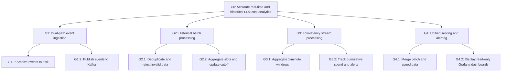

# Multi-Agent & Goal Hierarchy — `local_project`

## 1. System Expectations

| Area | Expected behavior | Implementation |
|---|---|---|
| Ingestion | 50 events/sec; each event sent to disk and Kafka with the same `event_id` | `producer.py`, `event_generator.py` |
| Data quality | 2% duplicates, 2% late events, 0.5% malformed events | `event_generator.py` |
| Stream processing | 10-second micro-batches; 1-minute windows; 30-second watermark | `stream_job.py` |
| Batch processing | Recompute history into 4-hour slots (09:00 and 13:00 UTC); update `cutoff_ts` | `batch_job.py` |
| No double counting | Batch: before `cutoff_ts`; Speed: from `cutoff_ts` onward | `serving.merged_view` |
| Budget alerts | Team caps: A $500, B $300, C $200; warning at 80%, critical at 100% | `budget_status`, `speed_alerts` |
| Dashboard | 8 panels; refresh every 10 seconds; read-only database access | Grafana, `grafana_ro` |

## 2. Agents and Execution Patterns

| Agent | Component | Main responsibility | Pattern |
|---|---|---|---|
| **A1 — Ingestion** | Producer | Generate events, inject test anomalies, write to disk and Kafka | Continuous |
| **A2 — Broker** | Kafka | Buffer events and decouple producers from consumers | Continuous |
| **A3 — Speed Layer** | Spark Streaming | Create 1-minute aggregates, running totals and budget alerts | Continuous + recursive state updates |
| **A4 — Batch Layer** | Spark Batch | Read history, deduplicate, reject invalid data, aggregate 4-hour slots and update cutoff | Periodic / one-shot |
| **A5 — Serving** | PostgreSQL | Store results, enforce uniqueness, merge batch and speed data | Reactive |
| **A6 — Monitoring** | Grafana | Display metrics and alerts through read-only queries | Periodic polling |

## 3. Functional vs. Interaction Objectives

**Functional objectives — what each agent does**
- **A1:** Generate valid LLM usage events and controlled anomalies.
- **A3:** Filter invalid events, apply watermarking, aggregate windows and maintain running totals.
- **A4:** Deduplicate history, classify rejected records, calculate slot costs and audit statistics.
- **A5:** Maintain database consistency, uniqueness and the batch-speed boundary.

**Interaction objectives — how agents coordinate**
- **A1 → Disk/Kafka:** Send the same event to both paths with identical IDs and timestamps.
- **A2 → A3:** Deliver Kafka events and support checkpoint-based recovery.
- **A3 ↔ A4:** Write to separate tables; coordinate through `batch_meta.cutoff_ts`.
- **A5 → A6:** Provide reconciled data to Grafana using read-only access.

## 4. Sender–Receiver–Message (SRM)

| Sender | Receiver | Channel | Message |
|---|---|---|---|
| A1 | Disk | JSONL files | Raw usage events |
| A1 | A2 | Kafka (`llm-usage-events`) | Same event payload, keyed by `event_id` |
| A2 | A3 | Spark Kafka source | Events, timestamps and offsets |
| A3 | A5 | JDBC | `speed_agg`, `speed_cumulative`, `speed_alerts` |
| Disk | A4 | Spark JSON reader | Historical JSONL data and pricing/budget data |
| A4 | A5 | JDBC | `batch_agg`, `batch_meta`, `dead_letter`, `dedup_stats` |
| A5 | A6 | PostgreSQL | Reconciled views, budget status and audit results |

## 5. Goal Hierarchy

## 6. Four Rules of a Well-Formed Goal Hierarchy

| Rule | Meaning | Result |
|---|---|---|
| **1. Completeness** | Sub-goals together achieve the parent goal | **Pass:** ingestion, batch, stream and serving cover the system goal |
| **2. Mutual exclusivity** | Sibling goals do not conflict or duplicate outputs | **Pass:** batch handles data before `cutoff_ts`; speed handles data from it onward |
| **3. Atomicity** | Each leaf goal maps to an executable action and verifiable output | **Pass:** each leaf maps to a script, SQL object or dashboard function |
| **4. Consistency / non-circularity** | Dependencies form an acyclic graph | **Pass:** data flows from ingestion to processing to serving |

## 7. Execution Pattern Classification

- **Continuous — A1 and A2:** Producer continuously generates events; Kafka continuously buffers them.
- **Recursive — A3:** Each micro-batch updates the previous checkpointed state:

  \[
  S_t = f(S_{t-1}, \Delta E_t)
  \]

  Here, \(S_{t-1}\) is the previous state and \(\Delta E_t\) is the newly received data.
- **Periodic / one-shot — A4:** Batch processing runs when triggered, recomputes historical data and updates `cutoff_ts`.
- **Periodic polling — A6:** Grafana refreshes dashboard panels every 10 seconds.
